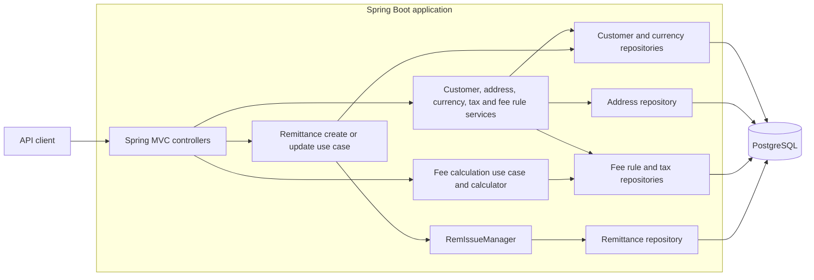

# Remittance Management

## Project Overview

Remittance Management is a personal backend engineering experiment built with Java and Spring Boot. It models customer and reference data, configurable fees and taxes, and outgoing remittance records. Fee calculation and remittance recording are separate API workflows.

## Project Objectives

- Explore how to organize a single Spring Boot application around business capabilities.
- Separate HTTP contracts, workflow orchestration, domain rules, and persistence so each can be tested at the appropriate level.
- Practice evolving a relational schema with versioned migrations and applying validation at the API, domain, and database layers.

## Technology Stack

| Area | Technology |
| --- | --- |
| Language and build | Java 26, Gradle Wrapper 9.5.1 |
| Application and HTTP | Spring Boot 4.0.6, Spring MVC, Jakarta Bean Validation, Spring Boot Actuator |
| Persistence | Spring Data JPA, Hibernate, PostgreSQL, Flyway |
| Code generation and API documentation | MapStruct 1.6.3, Lombok, springdoc-openapi 3.0.2 with Swagger UI |
| Testing | JUnit Jupiter, Mockito, AssertJ, Spring Boot Test |

## Architecture and Design

The repository builds one Spring Boot application. Java packages group code by business capability. Within a module, controllers handle HTTP, services and use cases coordinate operations, and Spring Data repositories provide persistence. Spring injects concrete services and use cases, repository interfaces, and generated mapper implementations. Most services and use cases use constructor injection, including Lombok-generated constructors. Some controllers use field injection.

The workflow modules reuse repositories across package boundaries. The pricing use case delegates to `FeeCalculator`, which loads tax and fee-rule data and calls the `FeeRule` entity for the fee formula. The remittance use case resolves the customer and currency, then delegates persistence to `RemIssueManager`.



## Project Structure

```text
src/
├── main/
│   ├── java/com/omar/remittance_management/
│   │   ├── RemittanceManagementApplication.java
│   │   ├── common/                 # Shared exceptions and API error handling
│   │   ├── home/                   # Greeting endpoint and Swagger redirect
│   │   └── modules/
│   │       ├── customer/           # Customer and address management
│   │       ├── currency/           # Currency reference data
│   │       ├── tax/                # Tax definitions and active-rate queries
│   │       ├── feeRule/            # Fee definitions, approval and selection
│   │       ├── feeCalculator/      # Pricing calculation and response assembly
│   │       └── remittanceIssue/    # Remittance record creation and updates
│   └── resources/
│       ├── application.properties
│       └── db/migration/           # Versioned PostgreSQL migrations
└── test/                           # Unit and Spring tests with test DB configuration
```

## Implemented Modules

| Module | Responsibility |
| --- | --- |
| Customer and address | Stores customer identity and contact information, checks national number and email uniqueness, and manages address records linked to a customer. Addresses carry a sort-order field. |
| Currency | Maintains reference records with a unique three-letter code and name, an optional symbol, and an activation flag. |
| Tax | Maintains named fractional rates and an active flag. The calculator consumes the active rates. |
| Fee rule | Models constant percentage rules and threshold-based rules. A threshold rule applies the rate from the highest threshold at or below the amount to the full amount. Rules have an effective date and an approval step. The service blocks edits to approved rules and currently records a placeholder approver. |
| Fee calculator | Selects the most recent approved rule whose effective date has arrived, applies active tax rates to the original amount, and returns separate fee and tax totals with typed line items. The fee total is zero when no rule qualifies. Calculations use `BigDecimal`. |
| Remittance issuance | Provides a create-or-update path for a remittance record. It resolves customer and currency IDs and copies the customer name, phone, and currency code onto the record alongside the amount and beneficiary details. |

## Engineering Features

- **API contracts and mapping.** Request and response DTOs define the HTTP payloads, mostly as Java records. MapStruct generates Spring mapper beans and flags unmapped target fields at compile time. Customer and address updates use `@MappingTarget` to map onto existing entities while preserving identifiers and associations. Workflow code assigns relationships and derived data explicitly.
- **Validation and error handling.** Selected controllers use `@Valid` for request constraints such as customer email format, currency code shape, and minimum remittance amount. Services and entities enforce rules such as uniqueness checks and fee-rule approval dates. The shared `@ControllerAdvice` maps business exceptions, request validation errors, and the project’s missing-entity exception to an `ApiError` with `status`, `message`, `code`, and `timestamp`. Business and request validation errors use HTTP 400. The shared missing-entity response currently sends HTTP 404 with `status: 400` in the body. Some lookups return an empty 404, and tax and currency services can throw exceptions outside the shared handler.
- **Persistence and schema evolution.** Spring Data `JpaRepository` interfaces use derived queries for lookups, uniqueness checks, and effective rule selection. Customers and fee rules manage their child collections through lazy JPA associations with cascading and orphan removal. The effective-rule query uses `@EntityGraph` to fetch fee-rule lines with the selected rule. Flyway applies pending migrations at startup, and Hibernate validates the schema. The nine versioned SQL migrations define foreign keys for addresses and fee-rule lines, uniqueness constraints, and checks for selected numeric fields.
- **Transaction boundaries.** Address, currency, tax, and fee-rule writes declare `@Transactional` at the service layer. Currency reads and selected fee-rule reads use read-only transactions. Customer writes, pricing, and remittance operations rely on transaction behavior at the individual repository call level.
- **Test coverage.** Domain tests exercise constant rates and threshold boundaries. Mockito tests cover fee-rule service decisions and pricing aggregation. A PostgreSQL-backed `@DataJpaTest` exercises effective-rule selection and uniqueness queries, and a `@SpringBootTest` checks application context startup. Automated coverage is concentrated on pricing and fee rules. Controller contracts and the remittance workflow lack dedicated tests.

## API Overview

| Route | Purpose |
| --- | --- |
| `/api/customers` | Customer records and address operations |
| `/api/currencies` | Currency records, code lookup, and activation changes |
| `/api/taxes` | Tax definitions and active-rate lookup |
| `/api/fee-rules` | Fee-rule configuration, with `POST /api/fee-rules/{id}/approve` and `GET /api/fee-rules/effective` |
| `POST /api/fees/calculate` | Accepts an `amount` and returns `totalFees`, `totalTaxes`, and `pricingItems` |
| `POST /api/remittance-issues` | Routes requests without `id` to creation and requests with `?id=<id>` to update |

For the full route and schema reference, open [Swagger UI](http://localhost:8080/api). The [OpenAPI document](http://localhost:8080/api-docs) is also available directly.

## Getting Started

Install JDK 26 and run a PostgreSQL server. From the repository root, use the included Gradle Wrapper. If `JAVA_HOME` is set, point it to the JDK 26 installation.

1. Create a PostgreSQL login role and an empty application database named `remittance_management_db`. Use a role that owns the database or can create and alter objects in the target schema. For the full test suite, create a separate `remittance_management_test_db` with the same access. The checked-in configuration expects PostgreSQL at `localhost:5432`.
2. Set your local datasource credentials and start the application. Flyway creates the tables in the provisioned database.

   ```sh
   export SPRING_DATASOURCE_URL=jdbc:postgresql://localhost:5432/remittance_management_db
   export SPRING_DATASOURCE_USERNAME=rem_db_admin
   export SPRING_DATASOURCE_PASSWORD='your-local-password'
   ./gradlew bootRun
   ```

3. Verify the HTTP server or try a pricing request from another terminal. An empty database returns zero fees and taxes because the migrations create the schema without seeding rates.

   ```sh
   curl --fail http://localhost:8080/api/hi
   curl --fail http://localhost:8080/api/fees/calculate \
     --header 'Content-Type: application/json' \
     --data '{"amount": 100.00}'
   ```

Run the full test suite with the test database URL and the corresponding credentials in the environment.

```sh
SPRING_DATASOURCE_URL=jdbc:postgresql://localhost:5432/remittance_management_test_db ./gradlew test
```

To run the unit tests without PostgreSQL, filter to `FeeRuleTest`, `FeeRuleServiceTest`, and `FeeCalculatorTest`.

## Project Status and Future Improvements

Remittance records include approval and cash-out fields. The corresponding workflows remain unimplemented.

- Add a JPA no-argument constructor to `IssRem` and verify create and update end to end. Revisit the future-or-present check on the generated issue timestamp and reconcile the required phone snapshot with optional customer phone data.
- Align request validation and error responses across modules. Start with tax request binding, pricing amount constraints, and consistent missing-record responses.
- Define monetary rounding and strengthen fee-rule integration coverage around rate precision, effective dates, and persistence of threshold updates.
